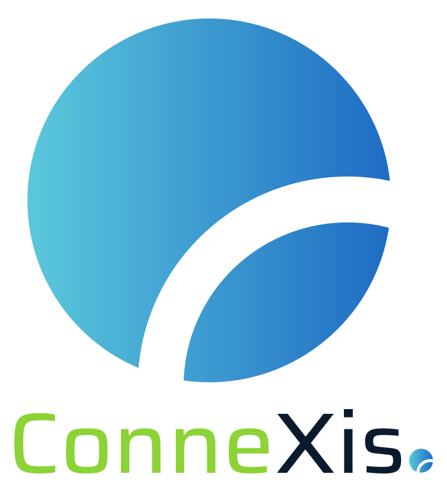
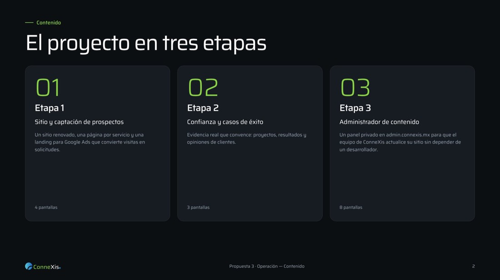
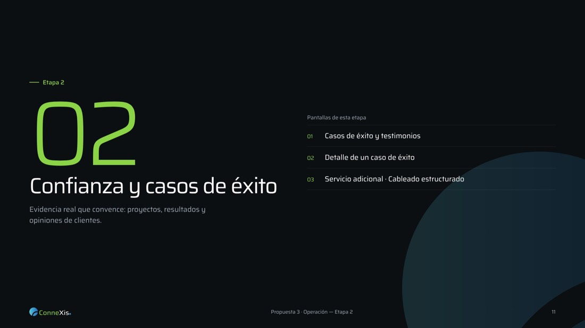
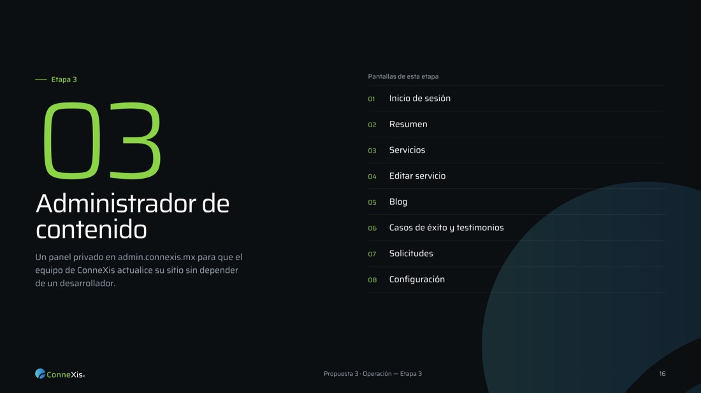

<p align="center">
  <picture>
    <source media="(prefers-color-scheme: dark)" srcset="brand/connexis-logo-oscuro.svg" />
    <source media="(prefers-color-scheme: light)" srcset="brand/connexis-logo-claro.svg" />
    
  </picture>
</p>

<p align="center">
  <strong>Ciberseguridad, redes y seguridad electrónica para PyMEs en Monterrey</strong><br />
  Sitio web oficial · <a href="https://connexis.mx">connexis.mx</a>
</p>

<p align="center">
  
  
  
  
  
</p>

---

## ¿Qué es este proyecto?

El sitio de ConneXis, construido con **Astro** sobre la *Propuesta 3 · Operación*: fondo carbón con verde lima, fotografía en blanco y negro, radar animado con el isotipo, servicios numerados y animaciones con **Motion**.

Esta versión **1.0.0** cubre la **Etapa 1: Sitio y captación de prospectos**: un sitio renovado, una página por servicio y una landing para Google Ads que convierte visitas en solicitudes. Las etapas 2 y 3 ya están diseñadas en la propuesta y parte de su código está listo pero comentado (ver [Siguientes etapas](#siguientes-etapas)).

📄 Propuesta completa: [`doc/connexis-propuesta-operacion-etapas.pdf`](doc/connexis-propuesta-operacion-etapas.pdf) · páginas en imagen en [`doc/propuesta/`](doc/propuesta).

<p align="center">
  
</p>

## Inicio rápido

```bash
npm install
npm run dev       # http://localhost:4321
npm run build     # genera /dist
npm run preview   # sirve /dist
```

Requiere Node 22.23 o superior (ver `.nvmrc`).

---

## Etapa 1 · Lo que incluye

| Pantalla | Ruta | Objetivo |
|---|---|---|
| Página principal | `/` | Presentar a ConneXis y llevar a solicitar un diagnóstico |
| Servicios (hub) | `/servicios` | Elegir servicio |
| Ciberseguridad | `/servicios/ciberseguridad` | Solicitar evaluación de seguridad |
| Redes empresariales | `/servicios/redes-empresariales` | Solicitar diagnóstico o cotización de red |
| Seguridad electrónica | `/servicios/seguridad-electronica` | Solicitar visita o asesoría |
| Landing Google Ads | `/evaluacion` | Un solo objetivo: pedir la evaluación (sin menú, `noindex`) |
| Agradecimiento | `/gracias` | Confirmar el envío y registrar la conversión (`noindex`) |
| Contacto | `/contacto` | Teléfono, WhatsApp, correo, dirección y formulario |
| Legales | `/aviso-privacidad`, `/terminos` | Aviso LFPDPPP, cookies y términos |
| Error | `/404` | Página de error personalizada |

Cableado estructurado y fibra óptica **solo se mencionan** en el home y la landing, sin página propia.

### SEO técnico

- URLs limpias, sin números ni conectores y sin diagonal final.
- Meta title y description únicos; **un solo H1 por página, distinto al meta title**; jerarquía H1 → H2 → H3.
- Primer párrafo que responde la **intención de búsqueda** y bloque **"En resumen"** (TL;DR) con los puntos clave.
- Tablas comparativas y listas donde ayudan a entender.
- **Schema** en un solo `@graph`: `LocalBusiness` + `ProfessionalService`, `WebSite`, `WebPage`, `BreadcrumbList`, `Service` y `FAQPage`.
- Open Graph por página (imagen recortada a 1200×630), favicon, manifest, `robots.txt`, `llms.txt` y `sitemap-index.xml` automático.
- Imágenes de Unsplash con nombre descriptivo y `alt`, convertidas a WebP con `srcset` ([créditos](CREDITOS-IMAGENES.md)).

### Conversión

- CTA principal visible sin hacer scroll en todas las páginas.
- **Barra fija en móvil** con *Llamar ahora*, WhatsApp y formulario; botón flotante de WhatsApp en escritorio.
- Formularios cortos con validación accesible, estado de carga y página de gracias.
- **Botón de compartir** en cada página (hoja nativa en móvil; WhatsApp, LinkedIn, Facebook, X y copiar enlace en escritorio).

### Animación (Motion)

Implementada en [`src/scripts/motion.ts`](src/scripts/motion.ts) con [Motion](https://motion.dev):

| Momento | Qué hace |
|---|---|
| Entrada del hero | Titular, texto y CTA suben en secuencia; el radar entra con resorte |
| Scroll | Tarjetas y secciones aparecen una a una (`inView` + `stagger`) |
| Progreso de lectura | Barra verde superior ligada al scroll |
| Botones | Respuesta táctil al presionar |
| Gracias | Ícono de confirmación con resorte |

Además: **loader animado** con el isotipo (primera visita de la sesión), radar y cinta de servicios en CSS. Con `prefers-reduced-motion` todo queda estático, y si Motion no carga el contenido se muestra igual.

### Accesibilidad (WCAG 2.2 AA)

Contraste ≥ 4.5:1 en todo el texto, enlace *Saltar al contenido*, foco visible, objetivos táctiles ≥ 44 px, formularios con `label` y errores anunciados, menú móvil con `aria-expanded` y cierre con Escape, íconos decorativos ocultos a lectores de pantalla y avisos en enlaces que abren otra pestaña.

---

## Analítica: GA4, Google Ads y Search Console

Variables en [`.env.example`](.env.example) (en Vercel o Netlify van en *Environment variables*):

| Variable | Uso |
|---|---|
| `PUBLIC_SITE_URL` | Dominio final (canonical, sitemap, OG) |
| `PUBLIC_GA4_ID` | GA4 `G-XXXXXXX` |
| `PUBLIC_GSC_VERIFICATION` | Valor `content` de la etiqueta de verificación de Search Console |
| `PUBLIC_GADS_ID` · `PUBLIC_GADS_CONVERSION_LABEL` | Conversión de Google Ads en `/gracias` |
| `PUBLIC_FORM_ENDPOINT` | Endpoint de formularios fuera de Netlify |

Consent Mode v2: todo inicia en `denied` y el banner de cookies lo cambia a `granted`.

| Evento | Cuándo |
|---|---|
| `generate_lead` | Llegada a `/gracias` tras un envío real (también dispara la conversión de Ads) |
| `click_to_call` · `click_whatsapp` · `click_email` | Clic en teléfono, WhatsApp o correo |
| `cta_click` | Clic en CTA principales |
| `form_start` · `form_error` · `form_send_error` | Interacción con formularios |
| `share` · `page_not_found` | Compartir y visitas a la 404 |

**Pasos con la cuenta de Google de ConneXis**

1. **GA4:** crear la propiedad y el flujo web de `https://connexis.mx`, copiar el ID a `PUBLIC_GA4_ID` y volver a desplegar. Marcar `generate_lead` y `click_to_call` como eventos clave.
2. **Search Console:** agregar la propiedad de dominio `connexis.mx` (registro TXT) o la de prefijo de URL con *Etiqueta HTML* → `PUBLIC_GSC_VERIFICATION`.
3. **Sitemap:** en *Sitemaps* enviar `sitemap-index.xml` y pedir la indexación del home y los tres servicios.
4. Vincular GA4 con Search Console y con Google Ads.

## Formularios y despliegue

- **Netlify:** [`netlify.toml`](netlify.toml) define build, Node 22, URLs limpias, redirecciones y cabeceras. Los formularios funcionan con Netlify Forms (honeypot incluido).
- **Vercel:** [`vercel.json`](vercel.json) define build, `cleanUrls`, redirecciones y cabeceras. Para los formularios configura `PUBLIC_FORM_ENDPOINT` (Formspree, Web3Forms, Basin…).
- En `npm run dev` el envío falla a propósito (no hay backend local) y muestra teléfono y WhatsApp como alternativa.

## Estructura

```
brand/                 Logos SVG originales y loader de referencia
doc/                   Propuesta en PDF y sus páginas en imagen
public/                robots.txt, llms.txt, favicon, íconos, OG por defecto
scripts/               Generación de íconos/OG y extracción de trazos del logo
src/
  assets/images/       Fotografías (nombre descriptivo = SEO)
  components/          Header, Footer, Seo, LeadForm, Faq, Tldr, Radar, Loader…
  data/                site.ts (negocio), services.ts (pilares), images.ts
  layouts/             BaseLayout (y PostLayout, Etapa 3)
  pages/               Rutas de la Etapa 1
    _casos-exito/      Etapa 2 · desactivada (el "_" evita que Astro la publique)
    _blog/             Etapa 3 · desactivada
  scripts/             motion.ts, forms.ts, site.ts
  styles/global.css    Tokens de diseño y estilos base
```

---

## Siguientes etapas

### Etapa 2 · Confianza y casos de éxito

Evidencia real que convence: proyectos, resultados y opiniones de clientes.

| Pantalla | Estado en el código |
|---|---|
| Casos de éxito y testimonios (sección del home + `/casos-exito`) | ✅ Construida y **comentada** (`ETAPA 2`) |
| Detalle de un caso de éxito (`/casos-exito/[caso]`) | ✅ Construida y **comentada** |
| Testimonios con nombre, puesto y empresa | ⏳ Pendiente (requiere testimonios autorizados) |
| Servicio adicional · Cableado estructurado | ⏳ Pendiente (en la Etapa 1 solo se menciona) |

**Para activarla:** renombrar `src/pages/_casos-exito` → `src/pages/casos-exito`, descomentar los bloques marcados `ETAPA 2` (`src/pages/index.astro`, `src/pages/servicios/[slug].astro`, `src/components/Footer.astro`, `src/data/site.ts`, `astro.config.mjs`, `netlify.toml`), agregar en `vercel.json` la redirección `/casos-de-exito → /casos-exito` y reemplazar los casos de ejemplo de `src/data/cases.mjs` por casos reales con `ejemplo: false`.

<p align="center"></p>

### Etapa 3 · Administrador de contenido

Un panel privado en `admin.connexis.mx` para que el equipo de ConneXis actualice su sitio sin depender de un desarrollador: inicio de sesión, resumen, servicios, edición de servicio, blog, casos de éxito y testimonios, solicitudes y configuración.

| Pieza | Estado en el código |
|---|---|
| Blog con tres guías de cluster (una por servicio) | ✅ Escrito y **comentado** (`ETAPA 3`, `src/pages/_blog`) |
| Panel de administración (8 pantallas) | ⏳ Pendiente |

**Para activar el blog:** renombrar `src/pages/_blog` → `src/pages/blog` y descomentar los bloques `ETAPA 3` (`src/pages/index.astro`, `src/pages/servicios/[slug].astro`, `src/pages/servicios/index.astro`, `src/components/Footer.astro`, `src/pages/404.astro`, `src/data/site.ts`, `astro.config.mjs`, `public/llms.txt`).

<p align="center"></p>

---

## Antes de publicar (pendientes de ConneXis)

Buscar `CONFIRMAR` en [`src/data/site.ts`](src/data/site.ts):

- Razón social, horario, coordenadas, tiempo de respuesta y que el número tenga WhatsApp.
- URLs de LinkedIn, Facebook e Instagram (solo se muestran las que existan).
- Fotos reales de instalaciones y equipo (ver [CREDITOS-IMAGENES.md](CREDITOS-IMAGENES.md)).
- Revisión legal del aviso de privacidad y los términos.

## Seguridad y licencia

- Reportes de seguridad: ver [SECURITY.md](SECURITY.md).
- **Software propietario.** © 2026 ConneXis. Todos los derechos reservados. Ver [LICENSE](LICENSE).

<p align="center"><sub>Desarrollado por David Cortez para ConneXis · Monterrey, N.L.</sub></p>
